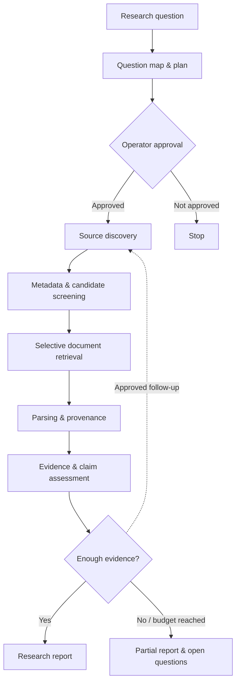

# Black Project

**Deep research with traceable evidence, explicit limits, and room to investigate further.**

Black Project is an experimental research system built around **GIDR (General Intelligence Deep Research)**. It investigates a question by breaking it into smaller research questions, finding relevant sources, retrieving selected documents, examining evidence, and recording what can and cannot be established.

The goal is not to produce the longest answer or collect the most links. It is to build a research trail that can be inspected: where an assertion came from, which passage supports it, what remains uncertain, and why the investigation stopped.

> **Project status — active development.** The GIDR terminal workflow has been tested with real OpenAlex discovery and document retrieval. In an operator-run experiment, two documents were retrieved and parsed into 38 text chunks; the resulting research assessment remained partial. Other source routes, model-assisted planning, and the wider investigative workflow are still being validated. This repository also contains an older DRX implementation described [below](#legacy-drx-implementation).

## Contents

- [What is deep research?](#what-is-deep-research)
- [What Black Project does](#what-black-project-does)
- [How it works](#how-it-works)
- [Getting started](#getting-started)
- [Running a research session](#running-a-research-session)
- [Sources, models, and evidence](#sources-models-and-evidence)
- [Current limitations](#current-limitations)
- [Legacy DRX implementation](#legacy-drx-implementation)
- [Development and testing](#development-and-testing)

## What is deep research?

A conventional search finds pages or documents related to a query. Deep research goes further: it identifies the questions that must be answered, checks different kinds of evidence, follows references where useful, and revises its understanding when evidence is missing or contradictory.

For example, researching the historical development of a surveillance institution may require official records, historical archives, scholarly analysis, and contemporary reporting. Those sources serve different purposes. A paper may explain scholarly interpretations; an archival document may establish what was recorded at the time. Neither should be treated as interchangeable with a search-result snippet.

Black Project approaches research as an **evidence-gathering process**, not a one-shot prompt to a language model.

## What Black Project does

The GIDR design has three research methodologies:

| Methodology | Intended focus |
| --- | --- |
| **General** | Build a structured understanding of a topic using relevant sources. |
| **Investigative** | Trace entities, events, relationships, records, and competing accounts. |
| **Scientific** | Examine research literature, methods, findings, datasets, and disagreements. |

The core workflow is designed to:

1. **Plan the investigation.** Turn a research objective into a question map and an approved execution plan.
2. **Discover sources.** Search eligible providers rather than relying on one web-search result list.
3. **Screen candidates.** Keep metadata for broad discovery; retrieve full text selectively when a document merits closer inspection.
4. **Preserve provenance.** Track source identity, document artifacts, hashes, passage locators, and the steps used to obtain them.
5. **Evaluate evidence.** Distinguish a quotation found in a document from an independently established factual conclusion.
6. **Report uncertainty.** Surface unanswered questions, insufficient support, conflicting evidence, and operational limits.

The system is built to support a bounded research process: the operator approves source access, budgets, and model-data use before execution. **An available adapter does not mean that its provider has been verified for a live run.**

## How it works



At a high level, the **Scheduler** coordinates work; **NetworkActionGate** and **FetchBroker** govern external requests; **ParserSandbox** handles supported retrieved content; and **StateAuthority** records durable research state. A separate assessment and reporting path checks evidence and coverage before presenting a result.

Some steps may use language models when a suitable route is configured and the operator explicitly authorizes it. Source discovery and document handling do not inherently require an LLM call.

### Evidence is not all the same

| Material | What it can establish |
| --- | --- |
| Search result | A lead worth investigating—not proof of a claim. |
| Metadata or CSV export | Bibliographic or structured facts within the source's stated coverage. |
| Abstract | A preliminary description suitable for relevance screening. |
| Retrieved full text | Passages that can be examined and cited against a stored artifact. |
| Assessed evidence | A documented judgment about support, limitations, and remaining uncertainty. |

An `INSUFFICIENT` or `PARTIAL` result is a valid outcome when available evidence does not justify a stronger conclusion.

## Getting started

### Requirements

- **Linux or WSL2** is the primary operator environment used during development.
- Python 3 with `venv` and `pip`.
- [Bubblewrap](https://github.com/containers/bubblewrap) (`bwrap`) for supported document-parsing isolation.
- A working system keyring backend **only if** you plan to use providers that require API credentials.
- Internet access **only for live provider experiments**, subject to explicit authorization.

These instructions assume you already have a local checkout of the repository. No public clone URL is asserted here.

### 1. Install the Python project

From the repository root:

```bash
cd black-project
python3 -m venv .venv-gidr
. .venv-gidr/bin/activate
python -m pip install --upgrade pip
python -m pip install -e .
```

The GIDR CLI is declared as a Python entry point. Check the installed interface before starting a session:

```bash
python -m gidr.interfaces.cli_minimal --help
```

> The exact dependency set is still evolving. If your checkout uses additional development requirements, consult its `pyproject.toml` and test configuration. Do not assume the old DRX `requirements-ml.txt` stack is necessary for a minimal GIDR run.

### 2. Check the document sandbox

Install Bubblewrap through your distribution's package manager if it is not already available, then run the focused PDF parsing test included with the project:

```bash
python -m pytest -q -rs -p no:cacheprovider \
  tests/unit/gidr/test_retrieval_parsing_b07.py::test_pdf_two_column_fixture_is_parsed_inside_sandbox \
  --tb=short
```

This test passed in the project's WSL operator environment during development. Results on other operating systems or sandbox configurations may differ; a skipped test is **not** a pass.

### 3. Configure credentials only when needed

GIDR uses credential aliases backed by a system keyring for supported providers. To check that the backend is usable:

```bash
python -m gidr.infrastructure.security.credentials_cli verify-backend
```

For example, to register an **existing** OpenAlex API key through hidden terminal input:

```bash
python -m gidr.infrastructure.security.credentials_cli set provider/openalex
python -m gidr.infrastructure.security.credentials_cli status provider/openalex
```

Never commit keys, paste them into issues, or include them in logs. A configured key does not automatically authorize network access, data transfer, or paid operations.

## Running a research session

Start the terminal interface from a **fresh working directory** so that experiment state and artifacts remain separate from other runs:

```bash
mkdir -p /tmp/gidr-first-run
cd /tmp/gidr-first-run
PYTHONPATH=/path/to/black-project/src \
  /path/to/black-project/.venv-gidr/bin/python \
  -m gidr.interfaces.cli_minimal \
  --providers openalex \
  --max-requests 8 \
  --max-tokens 0 \
  --max-cost-usd 0 \
  --concurrency 1 \
  --discovery-depth 1 \
  --soft-depth-horizon 1 \
  --runtime-seconds 120
```

Replace `/path/to/black-project` with the absolute path of your checkout. **This is a bounded example, not an unconditional full-text or zero-cost OpenAlex configuration.** OpenAlex metered operations, including content downloads, require the appropriate provider-cost approval and any currently supported content-host options; review `--help` and the experiment runbook before enabling them.

The CLI guides you through these steps:

1. Enter the research topic.
2. Choose a methodology and source categories.
3. Review the question map. The deterministic planner is available without model usage; generative planning requires a configured and approved model route.
4. Examine selected providers, allowed hosts, and effective budgets.
5. Approve the plan with `START`, then give `ALLOW NETWORK` only if you accept the displayed scope. Model-data consent is separate.
6. Review the saved result and its limitations.

After a run, the interactive workbench exposes read-only commands such as:

```text
/status
/questions
/sources
/evidence
/claims
/frontier
/activity
/budget
/report
/help
```

The workbench reads persisted state; it is **not** a full live-control TUI. Its post-run commands should not be mistaken for controls that can pause or resume an executing run.

### What to expect

A run may end with a partial report even when network access, download, and parsing worked correctly. For instance, finding two papers and extracting passages does not establish that every research question has been answered. The report should make that distinction explicit.

## Sources, models, and evidence

### Source providers

The existing GIDR implementation and tests include adapters for several kinds of discovery, among them **OpenAlex, arXiv, Crossref, GDELT, Wayback, Zenodo, GitHub, and SearXNG**. Their availability varies by adapter, configuration, host scope, API rules, and genuine live-verification status.

OpenAlex has been exercised in a human-operated run that reached metadata discovery, selected full-text retrieval, and parsing. This does **not** establish the same level of readiness for every other adapter.

Broader sources—government statistics, archives, court records, research repositories, investigative databases, and generic protocols such as CKAN, OAI-PMH, IIIF, or SPARQL—are **research and integration candidates**, not automatically installed production providers.

### Model-assisted work

GIDR is designed to support optional model tasks, including generative question mapping, factual claim proposals, and evidence-alignment assistance. Model routes must be configured and individually tested. In particular, **Jev/TypeSafe's integration is for advisory evidence alignment**, not a general-purpose generative planner. The assessment layer remains responsible for research verdicts.

No LLM response should be treated as a citation merely because it sounds plausible. Evidence must link back to retrievable source material, with its provenance and limitations retained.

### Resource and access controls

Network access, host allowlists, request ceilings, source API charges, model-data consent, and model costs are separate concerns. The implementation uses run-scoped provider verification and durable accounting to prevent a successful mock test from being presented as evidence of a real authorized provider call.

Research may be limited by inaccessible full text, paywalls, provider quotas, poor metadata, extraction errors, or contradictory sources. The expected behavior is to record these limits—not silently bypass them.

## Current limitations

Black Project remains under active development. In particular:

- An implemented source adapter is not equivalent to a live-verified service.
- The quality of deterministic question decomposition and candidate ranking is still being improved.
- Full-text access depends on provider availability, scope approval, licensing, and budget.
- Successfully extracted text does not by itself imply a supported factual claim.
- Generative model routes and Jev require separate live validation.
- The GIDR CLI is terminal-first; advanced graph exploration and persistent knowledge-workspace features belong to the broader product roadmap, not to the currently validated GIDR quickstart.

The project favors explicit `PARTIAL`, `INSUFFICIENT`, or blocked outcomes over an unsupported claim of completed research.

## Legacy DRX implementation

The repository also contains an earlier implementation, **DRX**, with a different interface and set of dependencies. Its main entry point is `main.py`; it should not be confused with the GIDR CLI.

The original README described a Python-first collection pipeline, optional LLM synthesis, interactive graph exploration, a local web interface, and an Internship Hunter module. Those details apply to the older implementation and may not reflect the current GIDR architecture.

If you specifically want to explore that implementation, start by checking its own requirements and command-line help:

```bash
python -m pip install -r requirements.txt
python main.py --help
```

Additional DRX features previously used `requirements-ml.txt`, Playwright Chromium, and optional SearXNG services. Install those only for the legacy features you intend to run. **Do not mix DRX configuration examples with GIDR's keyring, grants, and provider controls.**

## Development and testing

Run the relevant checks from the repository root using your configured environment:

```bash
python -m pytest -q tests/unit/gidr
```

For targeted debugging, prefer the specific failing module or test over running every suite indiscriminately. Offline fixture tests and production-network experiments answer different questions; both should be reported with their actual scope.

When contributing a source integration or research feature, document:

- the capability being added and why it contributes new information;
- its authentication, host, licensing, and budget requirements;
- how records, artifacts, and citation locators are preserved;
- what was verified offline versus with a genuine provider;
- failure cases and what the user sees when evidence is insufficient.

---

**Black Project is a research instrument in development.** Its progress is measured by the quality and traceability of evidence it can obtain—not by how many requests it sends or how confidently it writes a report.
