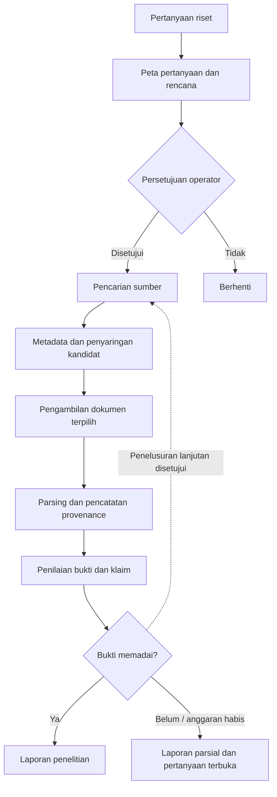

# Black Project

**Riset mendalam dengan bukti yang dapat ditelusuri, batas eksekusi yang jelas, dan ruang untuk penyelidikan lebih lanjut.**

[Bahasa Indonesia](README.id.md) · [English](README.md)

Black Project adalah sistem riset eksperimental yang dikembangkan melalui **GIDR (General Intelligence Deep Research)**. Alih-alih langsung menghasilkan jawaban panjang dari satu pertanyaan, GIDR memecah tujuan riset menjadi subpertanyaan, menemukan sumber yang relevan, mengambil dokumen terpilih, memeriksa bukti, dan mencatat bagian yang sudah maupun belum dapat dipastikan.

Tujuannya bukan mengumpulkan tautan sebanyak mungkin. Black Project berusaha membangun **jejak penelitian yang bisa diperiksa kembali**: dari mana sebuah pernyataan berasal, bagian dokumen mana yang mendukungnya, apa yang masih meragukan, dan mengapa proses penelitian berhenti.

> **Status proyek — masih dikembangkan.** Alur terminal GIDR telah diuji menggunakan pencarian OpenAlex dan pengambilan dokumen nyata. Pada salah satu eksperimen yang dijalankan operator, dua dokumen berhasil diambil dan diproses menjadi 38 potongan teks (*chunks*), tetapi penilaian hasil riset tetap `PARTIAL`. Provider lain, perencanaan berbantuan model, dan alur investigasi yang lebih luas masih memerlukan pengujian. Repositori ini juga memuat implementasi DRX lama yang dijelaskan [di bagian tersendiri](#implementasi-lama-drx).

## Daftar isi

- [Apa itu deep research?](#apa-itu-deep-research)
- [Apa yang dapat dilakukan Black Project?](#apa-yang-dapat-dilakukan-black-project)
- [Cara kerja sistem](#cara-kerja-sistem)
- [Instalasi](#instalasi)
- [Menjalankan penelitian](#menjalankan-penelitian)
- [Sumber, model, dan bukti](#sumber-model-dan-bukti)
- [Keterbatasan saat ini](#keterbatasan-saat-ini)
- [Implementasi lama: DRX](#implementasi-lama-drx)
- [Pengembangan dan pengujian](#pengembangan-dan-pengujian)

## Apa itu deep research?

Pencarian biasa membantu menemukan halaman atau dokumen yang berkaitan dengan sebuah kata kunci. *Deep research* melangkah lebih jauh: menguraikan masalah menjadi pertanyaan yang bisa diteliti, membandingkan berbagai jenis bukti, mengikuti rujukan yang relevan, dan meninjau kembali kesimpulan ketika informasi belum mencukupi atau saling bertentangan.

Sebagai contoh, penelitian mengenai sejarah sebuah lembaga pengawasan dapat membutuhkan arsip pemerintah, dokumen sejarah, artikel ilmiah, serta pemberitaan pada masanya. Masing-masing mempunyai fungsi berbeda. Artikel ilmiah dapat menjelaskan interpretasi para peneliti, sedangkan dokumen arsip dapat menunjukkan apa yang benar-benar dicatat pada periode tersebut. Keduanya tidak bisa disamakan dengan cuplikan hasil mesin pencari.

Black Project memperlakukan riset sebagai **proses pengumpulan dan pemeriksaan bukti**, bukan sekadar satu prompt yang diserahkan kepada model bahasa.

## Apa yang dapat dilakukan Black Project?

GIDR dirancang untuk tiga pendekatan penelitian:

| Pendekatan | Fokus |
| --- | --- |
| **General** | Membangun pemahaman terstruktur mengenai suatu topik dari sumber yang sesuai. |
| **Investigative** | Menelusuri entitas, peristiwa, hubungan, catatan, dan keterangan yang berbeda. |
| **Scientific** | Menelaah literatur ilmiah, metode, temuan, dataset, serta perbedaan hasil penelitian. |

Alur utama GIDR dirancang untuk:

1. **Menyusun rencana penelitian.** Mengubah tujuan riset menjadi peta pertanyaan (*Research Question Map*) dan rencana eksekusi yang perlu disetujui operator.
2. **Menemukan sumber.** Memanfaatkan provider yang diizinkan, bukan hanya mengandalkan satu daftar hasil pencarian web.
3. **Menyaring kandidat.** Menyimpan metadata untuk eksplorasi luas, lalu mengambil teks lengkap secara selektif ketika sebuah dokumen memang layak dibaca lebih jauh.
4. **Menjaga asal-usul bukti.** Mencatat identitas sumber, artefak dokumen, hash, lokasi kutipan, dan tahapan perolehannya (*provenance*).
5. **Menilai bukti.** Membedakan pernyataan yang ditemukan di dalam dokumen dari kesimpulan faktual yang sudah cukup teruji.
6. **Melaporkan ketidakpastian.** Menunjukkan pertanyaan yang belum terjawab, dukungan bukti yang lemah, kontradiksi, dan batasan proses penelitian.

Eksekusi bersifat terbatas dan memerlukan persetujuan. Operator menentukan akses sumber, batas request dan biaya, serta izin penggunaan model. **Keberadaan adapter tidak berarti provider tersebut sudah terverifikasi untuk eksekusi langsung (*live*).**

## Cara kerja sistem



Di balik alur tersebut, **Scheduler** mengatur pekerjaan; **NetworkActionGate** dan **FetchBroker** mengendalikan permintaan jaringan; **ParserSandbox** menangani konten yang didukung dalam lingkungan terisolasi; sedangkan **StateAuthority** menyimpan status dan jejak eksekusi secara persisten. Tahap penilaian dan pelaporan kemudian memeriksa keterkaitan bukti dengan pertanyaan riset sebelum menampilkan hasil.

Sebagian langkah dapat dibantu model bahasa jika route tersedia dan operator memberikan izin. Pencarian sumber serta pengambilan dokumen tidak harus melibatkan LLM.

### Tidak semua informasi memiliki tingkat pembuktian yang sama

| Materi | Apa yang dapat dibuktikan |
| --- | --- |
| Hasil pencarian | Petunjuk sumber untuk diselidiki, bukan bukti kebenaran klaim. |
| Metadata atau ekspor CSV | Fakta bibliografis atau data terstruktur sesuai cakupan sumbernya. |
| Abstrak | Gambaran awal untuk menilai relevansi dokumen. |
| Teks lengkap yang diambil | Bagian dokumen yang dapat diperiksa dan dikutip berdasarkan artefak tersimpan. |
| Bukti yang sudah dinilai | Penilaian terdokumentasi mengenai dukungan, keterbatasan, dan ketidakpastian. |

Status `INSUFFICIENT` atau `PARTIAL` merupakan hasil yang sah ketika bukti belum cukup untuk mendukung kesimpulan yang lebih kuat.

## Instalasi

### Persyaratan

- **Linux atau WSL2**, sebagai lingkungan utama yang digunakan dalam pengembangan dan pengujian operator.
- Python 3, `venv`, dan `pip`.
- [Bubblewrap](https://github.com/containers/bubblewrap) (`bwrap`) untuk isolasi parsing dokumen yang didukung.
- Backend *system keyring* yang berfungsi jika ingin menggunakan provider dengan API key.
- Koneksi internet hanya untuk eksperimen provider yang telah mendapat persetujuan operator.

Panduan ini mengasumsikan repositori sudah tersedia di komputer Anda. URL publik untuk `git clone` belum dicantumkan karena belum diverifikasi.

### 1. Siapkan lingkungan Python

Jalankan dari direktori utama repositori:

```bash
cd black-project
python3 -m venv .venv-gidr
. .venv-gidr/bin/activate
python -m pip install --upgrade pip
python -m pip install -e .
```

Periksa antarmuka CLI yang terpasang:

```bash
python -m gidr.interfaces.cli_minimal --help
```

> Dependensi proyek masih berkembang. Jika checkout yang digunakan memerlukan paket pengembangan tambahan, periksa `pyproject.toml` dan konfigurasi pengujiannya. Paket ML milik DRX lama tidak otomatis diperlukan untuk menjalankan GIDR secara minimal.

### 2. Periksa isolasi parser dokumen

Instal Bubblewrap melalui package manager distribusi Linux jika belum tersedia. Setelah itu jalankan pengujian PDF yang telah disediakan repositori:

```bash
python -m pytest -q -rs -p no:cacheprovider \
  tests/unit/gidr/test_retrieval_parsing_b07.py::test_pdf_two_column_fixture_is_parsed_inside_sandbox \
  --tb=short
```

Pengujian ini telah lulus di lingkungan WSL operator selama pengembangan. Hasil pada mesin dan konfigurasi sandbox lain dapat berbeda. Tes yang berstatus `SKIPPED` **tidak** boleh dianggap lulus.

### 3. Konfigurasikan credential bila diperlukan

GIDR menggunakan alias credential yang disimpan melalui *system keyring*. Periksa terlebih dahulu apakah backend tersedia:

```bash
python -m gidr.infrastructure.security.credentials_cli verify-backend
```

Misalnya, untuk memasukkan API key OpenAlex yang sudah Anda miliki melalui input terminal tersembunyi:

```bash
python -m gidr.infrastructure.security.credentials_cli set provider/openalex
python -m gidr.infrastructure.security.credentials_cli status provider/openalex
```

Jangan menambahkan API key ke Git, mengirimkannya melalui issue, atau menyertakannya dalam log. API key yang tersimpan **bukan** persetujuan otomatis untuk akses jaringan, pemindahan data, atau operasi API berbiaya.

## Menjalankan penelitian

Mulai sesi dari direktori kerja baru agar database eksperimen dan artefak tidak tercampur dengan run lain:

```bash
mkdir -p /tmp/gidr-first-run
cd /tmp/gidr-first-run
PYTHONPATH=/path/to/black-project/src \
  /path/to/black-project/.venv-gidr/bin/python \
  -m gidr.interfaces.cli_minimal \
  --providers openalex \
  --max-requests 8 \
  --max-tokens 0 \
  --max-cost-usd 0 \
  --concurrency 1 \
  --discovery-depth 1 \
  --soft-depth-horizon 1 \
  --runtime-seconds 120
```

Ganti `/path/to/black-project` dengan lokasi absolut repositori Anda. **Contoh ini menetapkan batas eksekusi, bukan otomatis mengaktifkan seluruh akses full text atau menjamin biaya OpenAlex nol.** Operasi OpenAlex yang dikenai tarif, termasuk unduhan dokumen, memerlukan persetujuan ceiling biaya provider dan opsi host konten yang berlaku. Periksa `--help` serta runbook eksperimen sebelum mengaktifkannya.

CLI akan memandu tahapan berikut:

1. Masukkan topik penelitian.
2. Pilih pendekatan penelitian dan kategori sumber.
3. Tinjau peta pertanyaan. Planner deterministik dapat digunakan tanpa LLM; planner generatif memerlukan route model yang dikonfigurasi dan disetujui.
4. Periksa provider, host yang diizinkan, dan batas penggunaan.
5. Setujui rencana dengan `START`; ketik `ALLOW NETWORK` hanya setelah menerima cakupan akses yang ditampilkan. Izin pengiriman data ke model diberikan secara terpisah.
6. Tinjau laporan serta keterbatasan hasilnya.

Setelah run berhenti, *workbench* menyediakan sejumlah perintah baca-saja:

```text
/status
/questions
/sources
/evidence
/claims
/frontier
/activity
/budget
/report
/help
```

Perintah-perintah ini membaca status yang telah tersimpan. Workbench **belum merupakan TUI penuh untuk mengendalikan penelitian yang sedang berlangsung**; perintah pascarun tidak berarti eksekusi aktif sudah dapat dijeda atau dilanjutkan secara interaktif.

### Memahami hasil penelitian

Sebuah run dapat menghasilkan laporan parsial meskipun koneksi jaringan, unduhan, dan parsing berhasil. Menemukan dua paper dan mengekstrak sejumlah kutipan belum berarti semua pertanyaan penelitian terjawab. GIDR berupaya menampilkan perbedaan tersebut secara eksplisit.

## Sumber, model, dan bukti

### Provider sumber

Implementasi GIDR memiliki adapter untuk berbagai kebutuhan discovery, antara lain **OpenAlex, arXiv, Crossref, GDELT, Wayback, Zenodo, GitHub, dan SearXNG**. Kesiapan masing-masing bergantung pada implementasi adapter, konfigurasi, domain yang diizinkan, aturan API, dan hasil pengujian nyata.

OpenAlex telah diuji oleh operator hingga tahap pencarian metadata, pengambilan teks lengkap secara selektif, dan parsing. Hasil tersebut **tidak** berarti semua provider lain memiliki tingkat kesiapan yang sama.

Sumber tambahan seperti statistik pemerintah, arsip sejarah, putusan pengadilan, repositori ilmiah, database investigatif, serta protokol CKAN, OAI-PMH, IIIF, dan SPARQL masih merupakan **kandidat riset dan integrasi**—bukan seluruhnya provider produksi yang sudah aktif.

### Penggunaan model bahasa

GIDR dirancang untuk mendukung pekerjaan berbantuan model, misalnya penyusunan peta pertanyaan generatif, pengusulan klaim faktual, dan penilaian alignment bukti. Setiap route model harus dikonfigurasi serta diuji sesuai kemampuannya. **Integrasi Jev/TypeSafe ditujukan untuk advisory evidence alignment**, bukan sebagai planner generatif serbaguna. Penilaian akhir tetap mengikuti aturan evidence dan assessment GIDR.

Jawaban LLM tidak otomatis menjadi sitasi. Bukti harus memiliki hubungan yang dapat ditelusuri ke materi sumber, beserta provenance dan keterbatasannya.

### Batas sumber daya dan akses

Izin jaringan, allowlist host, batas jumlah request, biaya API sumber, izin penggunaan data oleh model, dan biaya model adalah hal yang berbeda. GIDR menggunakan verifikasi provider per run dan pencatatan penggunaan secara persisten agar hasil tes sintetis tidak disalahartikan sebagai keberhasilan akses provider nyata.

Penelitian dapat terhambat oleh full text yang tidak tersedia, paywall, kuota API, metadata yang kurang lengkap, kegagalan ekstraksi, atau sumber yang saling bertentangan. Kondisi tersebut semestinya dicatat dan dilaporkan, bukan dilewati diam-diam.

## Keterbatasan saat ini

Black Project masih dalam pengembangan aktif. Beberapa batasan yang perlu diketahui:

- Adapter yang sudah dibuat belum tentu berhasil melewati verifikasi live.
- Kualitas pemecahan pertanyaan deterministik dan pemeringkatan kandidat masih ditingkatkan.
- Akses full text bergantung pada ketersediaan provider, persetujuan host, lisensi, dan budget.
- Kutipan yang berhasil diekstraksi belum otomatis membuktikan suatu klaim faktual.
- Route model generatif dan Jev masih memerlukan pengujian live tersendiri.
- GIDR berorientasi terminal. Eksplorasi graph tingkat lanjut dan *persistent knowledge workspace* masih termasuk arah pengembangan yang lebih luas, bukan fitur yang sudah divalidasi lewat panduan awal ini.

Sistem mengutamakan keluaran `PARTIAL`, `INSUFFICIENT`, atau `BLOCKED` yang jujur dibandingkan laporan penelitian selesai tanpa bukti memadai.

## Implementasi lama: DRX

Repositori ini juga memuat implementasi sebelumnya bernama **DRX**, dengan antarmuka dan dependensi berbeda. Entry point utamanya adalah `main.py`; jangan menyamakannya dengan CLI GIDR.

README lama menjelaskan pipeline pengumpulan data berbasis Python, sintesis LLM opsional, eksplorasi graph interaktif, web interface lokal, dan modul Internship Hunter. Fitur-fitur tersebut berkaitan dengan implementasi lama dan belum tentu mencerminkan arsitektur GIDR saat ini.

Jika Anda ingin mencoba DRX secara terpisah, mulai dengan memeriksa dependensi dan bantuan CLI-nya:

```bash
python -m pip install -r requirements.txt
python main.py --help
```

Fitur DRX tertentu sebelumnya memanfaatkan `requirements-ml.txt`, Playwright Chromium, dan layanan SearXNG opsional. Pasang hanya dependensi yang dibutuhkan oleh fitur lama yang ingin dijalankan. **Jangan mencampurkan konfigurasi DRX dengan keyring, grant, dan aturan akses provider GIDR.**

## Pengembangan dan pengujian

Jalankan pengujian dari direktori utama repositori menggunakan environment yang telah dikonfigurasi:

```bash
python -m pytest -q tests/unit/gidr
```

Saat menemukan kegagalan, lebih baik jalankan modul atau test case yang relevan daripada langsung mengulang seluruh test suite. Pengujian offline berbasis fixture dan eksperimen jaringan produksi menjawab pertanyaan berbeda; hasil keduanya harus dilaporkan sesuai cakupannya.

Ketika menambahkan integrasi sumber atau fitur penelitian, dokumentasikan:

- kemampuan baru dan nilai informasi tambahan yang diberikannya;
- persyaratan autentikasi, domain, lisensi, serta budget;
- bagaimana sumber, artefak, dan lokasi kutipan disimpan;
- bagian yang telah diuji offline dan yang benar-benar dibuktikan melalui provider live;
- kondisi gagal dan informasi yang diperlihatkan ketika bukti belum mencukupi.

---

**Black Project adalah instrumen penelitian yang masih berkembang.** Kemajuannya diukur dari kualitas dan keterlacakan bukti yang berhasil diperoleh—bukan dari banyaknya request atau seberapa meyakinkan bahasa laporan yang dihasilkan.
