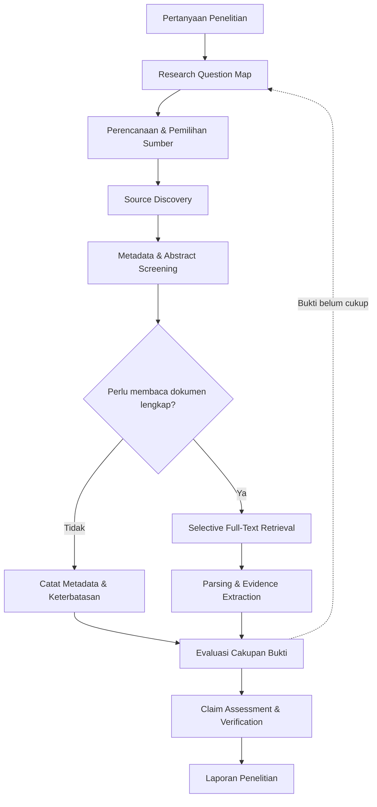

# Black Project

**Black Project** adalah proyek pengembangan mesin penelitian mendalam (*deep research engine*) yang dirancang untuk menelusuri, menghubungkan, dan mengevaluasi informasi dari berbagai sumber secara sistematis.

Inti pengembangannya adalah **GIDR (General, Investigative, and Scientific Deep Research)**, sebuah sistem yang menggabungkan pengumpulan data terprogram, analisis berbantuan model bahasa, dan pemeriksaan bukti untuk membantu menjawab pertanyaan penelitian yang kompleks.

Black Project tidak dirancang hanya untuk menghasilkan jawaban cepat. Fokusnya adalah membangun proses penelitian yang dapat ditelusuri: dari mana informasi ditemukan, bagaimana sebuah klaim terbentuk, bukti apa yang mendukungnya, serta bagian mana yang masih belum dapat dipastikan.

## Pendekatan Penelitian

GIDR dirancang untuk mendukung tiga pendekatan utama:

| Pendekatan | Fokus |
|---|---|
| **General Research** | Eksplorasi topik, pengumpulan informasi, perbandingan sumber, dan penyusunan pemahaman yang menyeluruh. |
| **Investigative Research** | Penelusuran peristiwa, entitas, hubungan, dokumen historis, serta pemeriksaan klaim dan kontradiksi. |
| **Scientific Research** | Kajian literatur ilmiah, analisis metodologi, pembandingan hasil penelitian, dan pemeriksaan bukti akademik. |

Ketiga pendekatan tersebut menggunakan fondasi sistem yang sama, tetapi membutuhkan strategi pencarian, jenis sumber, dan kriteria evaluasi yang berbeda.

## Cara Kerja

Penelitian dimulai dari pertanyaan pengguna. GIDR kemudian menyusun peta pertanyaan penelitian (*Research Question Map*) untuk menentukan informasi yang diperlukan dan sumber yang mungkin relevan.

Sumber ditemukan melalui provider yang tersedia, kemudian disaring berdasarkan metadata, abstrak, dan kebutuhan bukti. Dokumen lengkap hanya diambil secara selektif ketika diperlukan untuk analisis lebih mendalam.

Proses ini mengikuti prinsip **Progressive Evidence Acquisition**: menemukan sumber secara luas, menyaring kandidat dengan biaya rendah, dan membaca mendalam hanya sumber yang memiliki kontribusi penting terhadap pertanyaan penelitian.

## Prinsip Pengembangan

Black Project dibangun dengan beberapa prinsip:

- **Evidence-first:** klaim harus dapat ditelusuri ke bukti yang mendasarinya.
- **Traceable provenance:** asal sumber, dokumen, dan kutipan dipertahankan untuk pemeriksaan ulang.
- **Selective retrieval:** tidak semua kandidat perlu diunduh dan dianalisis secara penuh.
- **Explicit uncertainty:** informasi yang belum cukup didukung bukti harus dinyatakan sebagai belum pasti.
- **Bounded execution:** penggunaan jaringan, model AI, waktu, dan biaya dibatasi oleh konfigurasi serta persetujuan operator.
- **Human oversight:** keputusan penting tetap berada dalam kendali pengguna.

Tujuannya bukan menggantikan penilaian peneliti, melainkan menyediakan infrastruktur yang membantu penelitian dilakukan secara lebih terstruktur dan dapat diaudit.

## Ekosistem Sumber

GIDR dikembangkan untuk bekerja dengan berbagai kategori sumber, antara lain:

| Kategori | Contoh sumber |
|---|---|
| Literatur ilmiah | OpenAlex, arXiv, Crossref |
| Berita dan peristiwa | GDELT |
| Arsip web | Wayback Machine |
| Dataset dan artefak penelitian | Zenodo |
| Kode dan repositori | GitHub |
| Pencarian web | SearXNG |

Perluasan menuju data pemerintah, statistik, dokumen hukum, arsip sejarah, dan sumber investigatif juga menjadi bagian dari arah pengembangan.

**Daftar sumber tidak berarti seluruh integrasinya telah aktif atau diverifikasi secara langsung.** Ketersediaan setiap provider bergantung pada implementasi, konfigurasi, akses API, dan persetujuan operator.

## Status Pengembangan

Black Project masih dalam pengembangan aktif.

Sejumlah komponen GIDR telah diuji menggunakan pengujian lokal maupun eksperimen langsung, termasuk discovery sumber, pengambilan dokumen OpenAlex, parsing, serta pencatatan bukti.

Namun, keberhasilan komponen tertentu tidak berarti seluruh alur penelitian otonom telah tervalidasi. Kualitas pemilihan sumber, kecukupan bukti, integrasi model, dan penelitian investigatif end-to-end masih memerlukan pengujian lebih lanjut.

Implementasi sebelumnya, **DRX (Deep Research eXperimental)**, tetap menjadi bagian dari riwayat pengembangan proyek dan dipisahkan dari arsitektur GIDR yang lebih baru.

## Dokumentasi

Dokumentasi lengkap tersedia dalam dua bahasa:

- **[Dokumentasi Bahasa Indonesia](README.id.md)** — pengenalan mendalam, instalasi, konfigurasi, penggunaan CLI, dan arsitektur sistem.
- **[English Documentation](README.en.md)** — complete documentation covering installation, configuration, usage, and architecture.

Untuk mencoba Black Project pada lingkungan lokal, mulailah dari bagian instalasi dalam dokumentasi sesuai bahasa yang Anda pilih.

---

**Black Project** — membangun mesin penelitian yang tidak hanya menemukan informasi, tetapi juga mempertanyakan, memeriksa, dan mempertanggungjawabkan bukti di baliknya.
